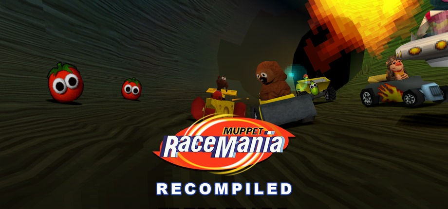
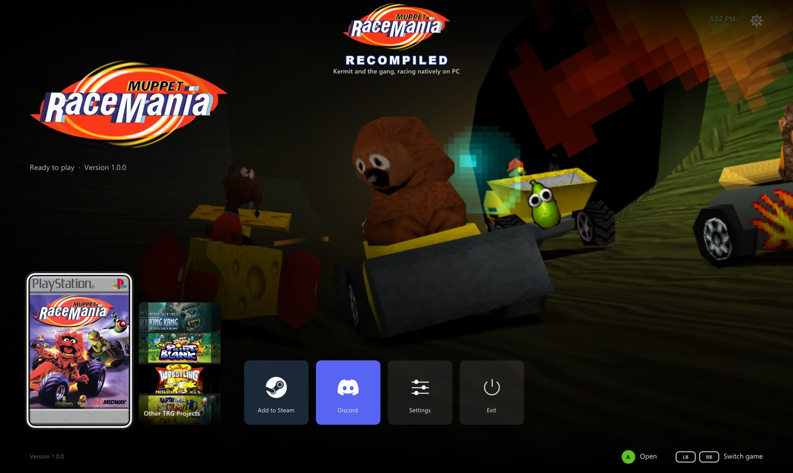
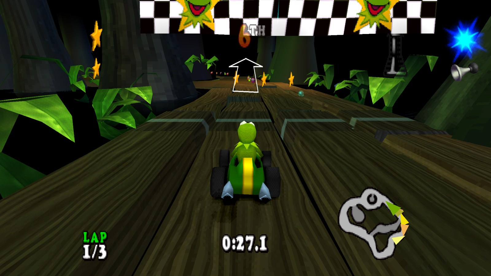
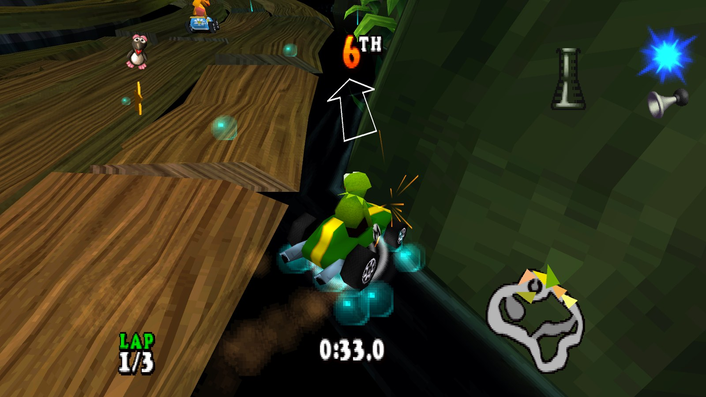
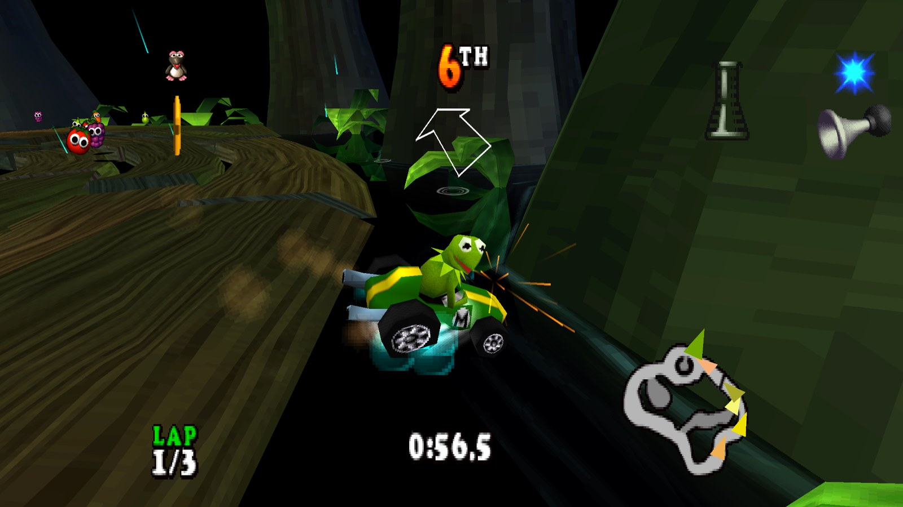
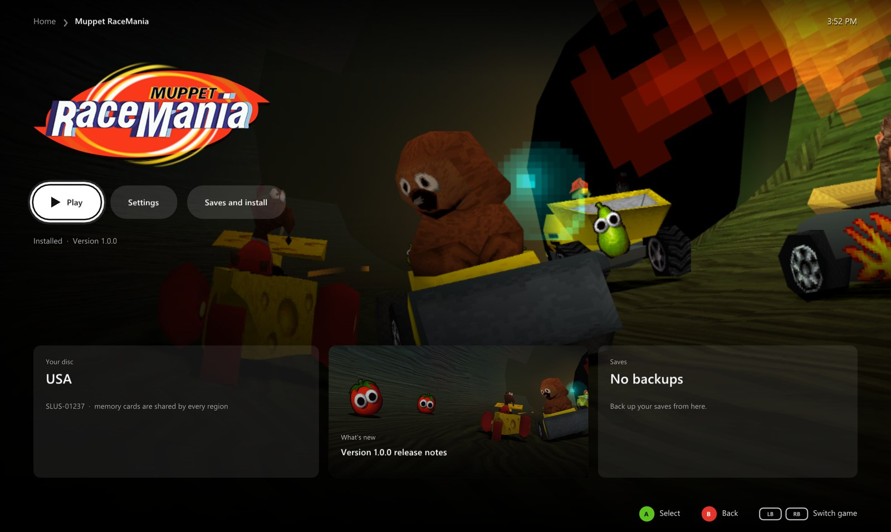
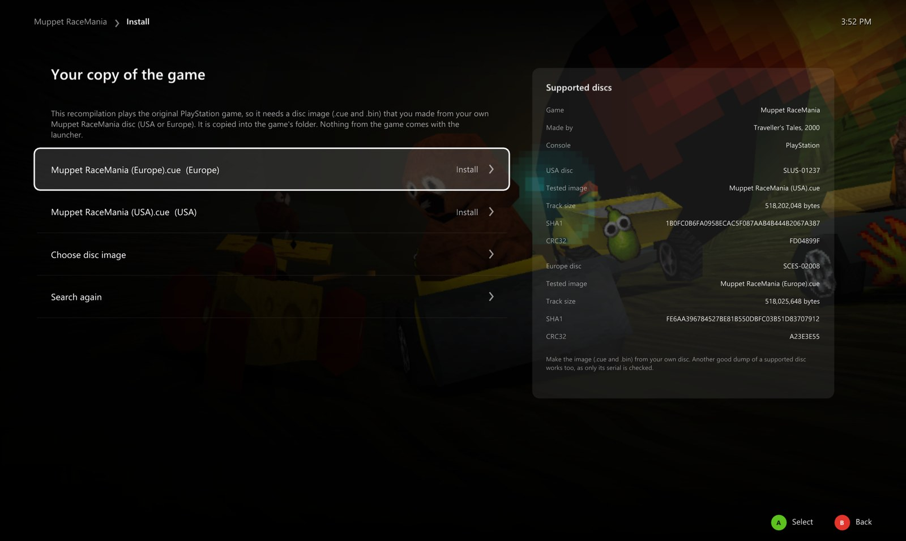
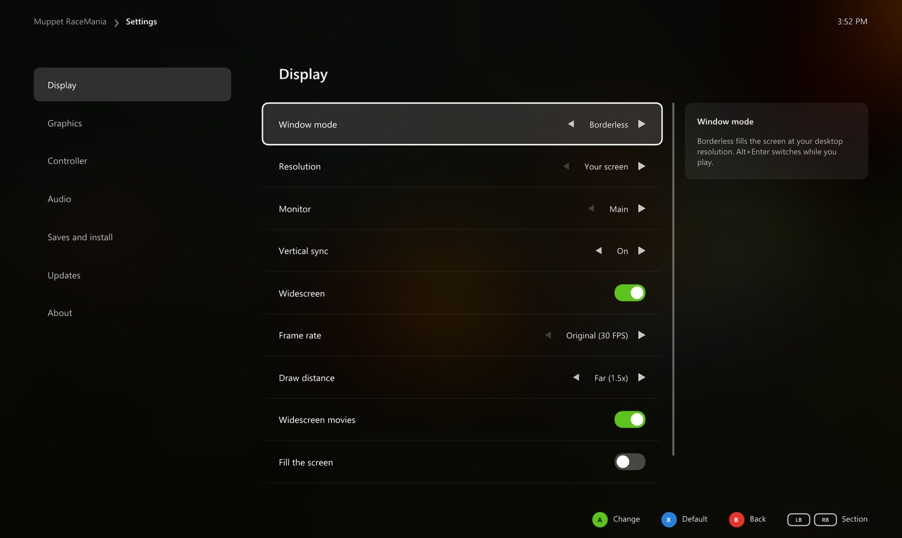
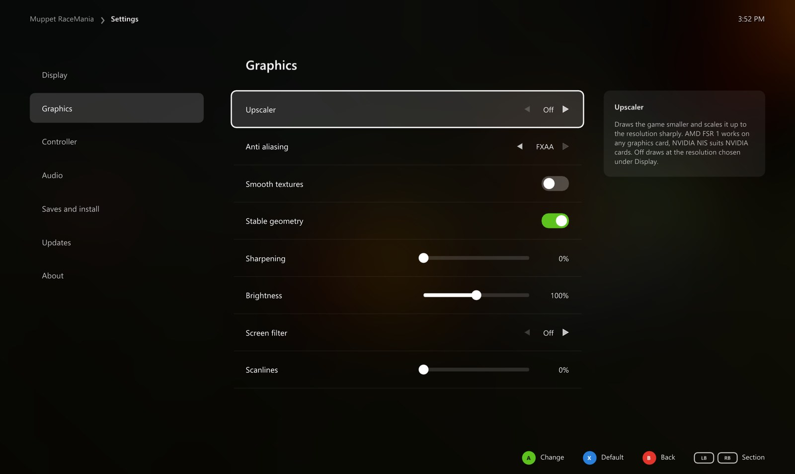
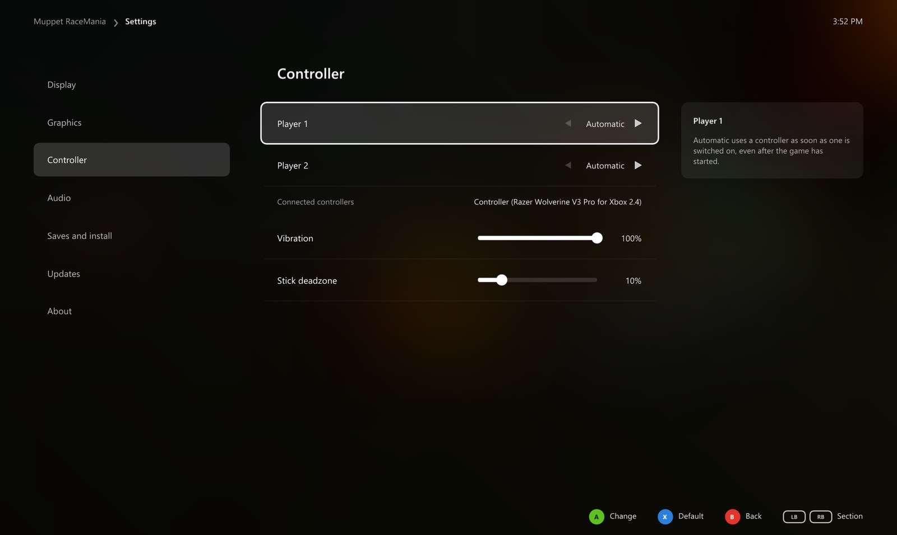

<div align="center">



### Muppet RaceMania on PC, running natively in 16:9 and at 60 FPS, in a launcher made for the couch.

[](https://github.com/TekRantGaming/muppet-racemania-recompiled/releases/latest)
&nbsp;
[](https://github.com/TekRantGaming/muppet-racemania-recompiled/releases/latest)
&nbsp;
[](https://discord.gg/8eakYSvBZS)

[](https://github.com/TekRantGaming/muppet-racemania-recompiled/releases/latest)
[](https://github.com/TekRantGaming/muppet-racemania-recompiled/releases)


<br>







<sub>The original PlayStation game code, translated to native PC code with <a href="https://github.com/mstan/psxrecomp">psxrecomp</a>. <b>No game files included</b>: bring a disc image of your own USA or Europe disc. The launcher walks you through it.</sub>

</div>

<br>

## At a glance

| | | |
| :--- | :--- | :--- |
| 🏁 **Native PC port** of the 2000 kart racer, from your **USA or Europe disc** | 🖥️ **Up to 4K**, or whatever your screen is | 📺 **16:9 widescreen** with a wider view of the track |
| 🎞️ **60 FPS** (50 on a Europe disc), still at the right speed | 🛣️ **Draw distance** up to double the original | ✨ **AMD FSR 1, NVIDIA NIS** and **FXAA** |
| 🎮 **Any controller**, or the keyboard | ↩️ **Back to the launcher** any time: hold Back + Start, or Esc | 💿 **Install from your own disc image**, with the disc checked for you |
| 🛋️ **A console style dashboard** with sounds, made for a controller | 🔄 **Updates itself** and the game | 💾 **Save backups** and restore in one click |
| 🪟 **Borderless, exclusive or windowed**, any monitor | 🚂 **Add to Steam** with its own artwork | 🐧 **Linux** too, as one AppImage |

## Getting started

**You need:** Windows 10 or 11 (64 bit) or Linux, a graphics card with OpenGL 3.3 (4.3 for the upscalers), and a disc image you made from your own disc (see [Which discs you need](#which-discs-you-need)). The disc image is a `.cue` with its `.bin`.

1. Download **MuppetRaceManiaRecompiled-...-windows-x64.zip** from the [latest release](https://github.com/TekRantGaming/muppet-racemania-recompiled/releases/latest) and unzip it anywhere. It holds the launcher and the game, and everything stays in that folder, so it's portable.
2. Run **MuppetRaceMania.exe**. It opens in fullscreen on Home. Windows may warn about an unknown publisher the first time: choose **More info**, then **Run anyway**.
3. Press **Play**. The first time, the launcher asks for your disc image: choose the `.cue` file, and it checks the disc and copies it next to the game.
4. Press **Play** again, and from then on it starts straight away.

While you play, **hold Back and Start** on the controller, or **hold Esc**, to come back to the launcher. **No game files are included**: they come from your own disc. Your memory cards are kept in `saves\muppet_racemania` beside the launcher.

### Linux

1. Download **MuppetRaceManiaRecompiled-...-linux-x86_64.AppImage** from the [latest release](https://github.com/TekRantGaming/muppet-racemania-recompiled/releases/latest).
2. Make it executable (right click it, **Properties**, **Permissions**, **Allow executing file as program**, or `chmod +x` in a terminal) and run it. The launcher and the game are inside.
3. Everything else works as on Windows: press **Play**, and choose your disc image the first time.

The game, your disc image, the settings and your memory cards go in `~/.local/share/muppet_racemania`. The AppImage updates itself like the Windows version, and **Add to Steam** on Home puts it in your Steam library with its artwork. It hasn't been tried on a Steam Deck yet, so please tell us how it goes.

### Which discs you need

The two discs are different programs, so the port has a build for each and the launcher starts the right one. Only the serial is checked, so any good dump of these two discs works. Other releases of the game have other serials and aren't supported. These are the images the port was made and tested with:

| Region | Serial | Disc image | SHA1 | Installed |
| --- | --- | --- | --- | --- |
| USA | `SLUS-01237` | 518,202,048 bytes | `1B0FC0B6FA0958ECAC5F087AAB4B444B2067A387` | about 500 MB |
| Europe | `SCES-02008` | 518,025,648 bytes | `FE6AA396784527BE81B550DBFC03B51D83707912` | about 500 MB |

The launcher's install screen shows every detail for each disc, MD5 and CRC32 too. To check a disc image yourself, run this in PowerShell on the `.bin` and compare the result with the SHA1 above:

```powershell
Get-FileHash "C:\Games\Muppet RaceMania (USA).bin" -Algorithm SHA1
```

## The launcher

Everything is set up before the game starts, with a controller, the keyboard or the mouse.

<table>
<tr>
<td width="55%"></td>
<td valign="middle">

### Home
- The game's artwork, whether it's **ready to play**, and its version
- **Settings** for the launcher
- **Add to Steam**: adds the game to your Steam library as a non Steam game, with its own artwork, and switches Steam Input off for it so your controller keeps working. Steam closes for a moment while it's added and opens again afterwards
- **Discord**: joins the official server
- Plays with a **controller**, the **keyboard** or the **mouse**, with interface sounds

</td>
</tr>
<tr>
<td valign="middle">

### Game page
- **Play**, the only place the game starts
- **Settings** and **Saves and install**
- Your **save backups** and the **release notes** of the latest version

</td>
<td width="55%"></td>
</tr>
<tr>
<td></td>
<td valign="middle">

### Install from your own disc
- **Choose your disc image**, or drop it on the window
- A card shows **exactly which discs work**: serial, size, SHA1, MD5 and CRC32
- It checks the disc really is this game, then copies it with a progress bar

</td>
</tr>
<tr>
<td valign="middle">

### Display
- **Borderless**, **exclusive** or **windowed**, **choose the monitor**, vertical sync
- **Resolution**: your screen, 720p, 1080p, 1440p or 4K
- **Widescreen**: 16:9 with the wider view of the track
- **Frame rate**: 30 like the PlayStation, or **60**
- **Draw distance**: Original, Far (1.5x, the default) or Farther (2x)
- **Widescreen movies**, **fill the screen** and a **frame rate counter**

</td>
<td width="55%"></td>
</tr>
<tr>
<td></td>
<td valign="middle">

### Graphics
- **Upscaler**: AMD FSR 1 or NVIDIA NIS, with Quality, Balanced and Performance modes and their sharpness
- **FXAA**, **smooth textures** and **stable geometry**, which stops the PlayStation's polygon wobble
- **Sharpening** and **brightness**
- **Screen filters**: CRT, Composite or Trinitron, with **scanlines**

</td>
</tr>
<tr>
<td valign="middle">

### Controller and sound
- **Player 1** and **Player 2**, each on a controller or the keyboard
- **Vibration** and **stick deadzone**
- **Volume**, **sound delay** and **high quality audio**

</td>
<td width="55%"></td>
</tr>
</table>

### Saves and updates

**Saves and install** backs up your memory cards and restores them, opens the save, backup and game folders, reinstalls from your disc or removes the game. When the launcher opens it checks GitHub for a new version and **installs it by itself**, restarting into the new launcher once nothing else is going on; your disc image, saves and settings stay as they are. Turn that off in the launcher's own **Settings**.

## PlayStation vs PC

| | PlayStation | PC |
| --- | :---: | :---: |
| Resolution | 512 x 240 | your screen, up to 4K |
| Picture | 4:3 | 16:9 with a wider view, or 4:3 |
| Frame rate | 30 fps (25 in Europe), often lower | 30 or **60** (25 or 50 in Europe) |
| Draw distance | short | up to 2x |
| Upscaling | none | AMD FSR 1 or NVIDIA NIS, three modes each |
| Anti aliasing | none | FXAA |
| Polygons | wobble | steady, with stable geometry |
| Display | TV | borderless, exclusive or windowed, any monitor |
| Controls | DualShock | any controller, or the keyboard |

## Good to know

### What changes in widescreen

The race itself fills 16:9: the track and karts at the sides of the screen are drawn by the game, not stretched. Menus and loading screens keep their 4:3 picture. The game's movies are made in 4:3, so **Widescreen movies** zooms them to fill the screen, trimming a little from the top and bottom. Turn it off to see them in 4:3 with black bars.

### 60 FPS

The game moves everything by the time each frame took, so races run at the same speed at 30 and 60. 60 FPS needs a faster CPU, because the emulated PlayStation processor runs at three times its speed to fit a race frame in. A Europe disc runs at 50 FPS, like its TV standard.

### Keyboard

| Key | PlayStation button |
| --- | --- |
| <kbd>Arrow keys</kbd> | D-pad and left stick |
| <kbd>X</kbd> | Cross (accelerate) |
| <kbd>S</kbd> | Circle |
| <kbd>Z</kbd> | Square |
| <kbd>A</kbd> | Triangle |
| <kbd>Q</kbd> <kbd>W</kbd> <kbd>E</kbd> <kbd>R</kbd> | L1, R1, L2, R2 |
| <kbd>Return</kbd> | Start |
| <kbd>Right Shift</kbd> | Select |

To change them, edit `keybinds.ini` in the game's folder (`games\muppet_racemania\usa` or `eur`).

### Hotkeys

| Key | Action |
| --- | --- |
| Hold <kbd>Back</kbd> + <kbd>Start</kbd>, or hold <kbd>Esc</kbd> | back to the launcher while playing |
| <kbd>Alt</kbd> + <kbd>Enter</kbd> | fullscreen or windowed while playing |
| <kbd>F11</kbd> | the launcher fullscreen or windowed |

### Reporting a problem

Please open an [issue](https://github.com/TekRantGaming/muppet-racemania-recompiled/issues) with which disc you use, what happened, your CPU, graphics card and the resolution and frame rate you play at, or ask on the [Discord](https://discord.gg/8eakYSvBZS).

## About the game

*Muppet RaceMania* is a kart racer developed by Traveller's Tales with Jim Henson Interactive, released on the PlayStation in 2000. Midway published it in North America and Sony Computer Entertainment in Europe. Kermit, Miss Piggy, Gonzo, Animal and the rest of the gang race through tracks set in the Muppet movies.

Until now the only way to play it was on a PlayStation or an emulator. This port runs it natively on PC and adds the options you would expect from a PC release.

<details>
<summary><b>Building from source (for developers)</b></summary>

See [BUILDING.md](BUILDING.md). The game code is generated from each disc's own program, so building needs your own disc too. It is never committed.

</details>

## Credits

- **Muppet RaceMania** by Traveller's Tales with Jim Henson Interactive, published by Midway and Sony Computer Entertainment in 2000.
- [**psxrecomp**](https://github.com/mstan/psxrecomp) by Matthew Stanley and its contributors, which translates the PlayStation code and runs it, under the [PolyForm Noncommercial License 1.0.0](https://polyformproject.org/licenses/noncommercial/1.0.0).
- [**OpenBIOS**](https://github.com/grumpycoders/pcsx-redux) from PCSX-Redux, the free PlayStation BIOS the game boots on, MIT licensed.
- [**Dear ImGui**](https://github.com/ocornut/imgui), [**SDL**](https://www.libsdl.org) and [**stb**](https://github.com/nothings/stb) for the launcher.
- The [**TRG Launcher**](https://github.com/TekRantGaming/trg-launcher), shared by the TekRantGaming ports.
- Game artwork in the launcher from [**SteamGridDB**](https://www.steamgriddb.com), downloaded when the launcher runs.
- The Discord and Steam marks from [**Simple Icons**](https://simpleicons.org) (CC0). Discord and Steam are trademarks of their owners.
- Upscaling: [**AMD FidelityFX Super Resolution 1**](https://github.com/GPUOpen-Effects/FidelityFX-FSR) and the [**NVIDIA Image Scaling SDK**](https://github.com/NVIDIAGameWorks/NVIDIAImageScaling), both MIT licensed.

The licences of everything above that ships with the game are in the release's `licenses` folder.

> [!NOTE]
> **AI disclosure:** this port was made almost entirely with Claude Code (Anthropic). The repository owner directed and tested the work; the AI did the analysis, code, tools and documentation.

> [!IMPORTANT]
> This project is not affiliated with or endorsed by The Jim Henson Company, The Muppets Studio, Disney, Traveller's Tales, Midway, Sony, Valve or Discord. All trademarks belong to their owners. The repository and the releases contain no game code, disc data or Sony BIOS. Do not open issues asking for game files.
